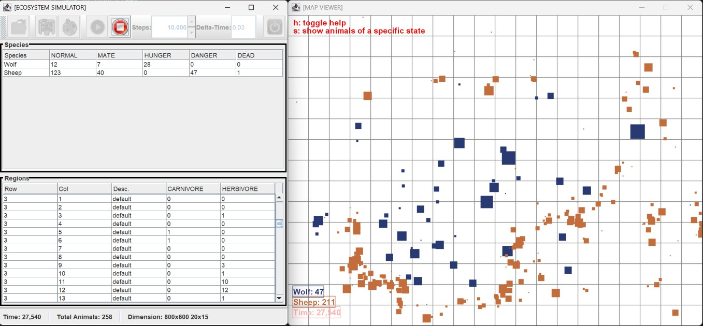
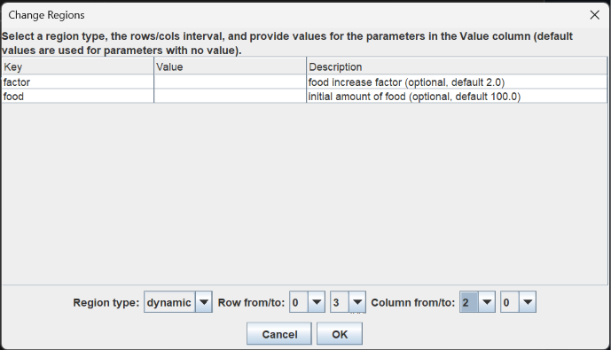
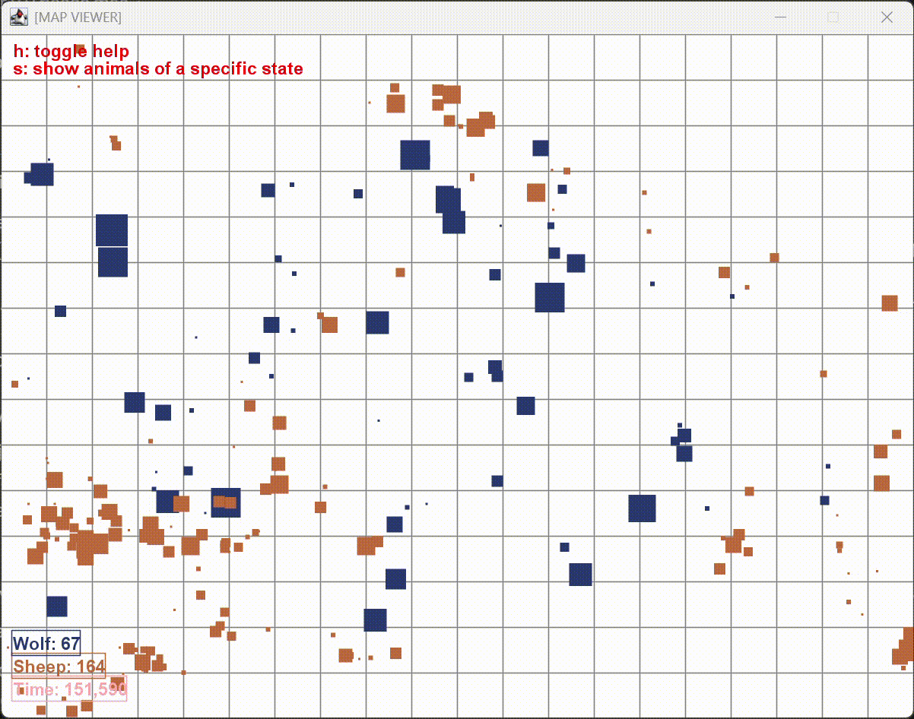

# Simulador de Ecosistema

Simulador de un ecosistema de **ovejas y lobos** desarrollado en **Java 21** con interfaz **Swing** para la asignatura *Tecnología de la Programación 2*. Cada animal es una máquina de estados que busca comida, pareja o huye del peligro sobre un mapa dividido en regiones con distinta cantidad de alimento.



---

## Características

- Dos especies: **ovejas** (herbívoras) y **lobos** (carnívoros). Cada animal pasa por los estados `NORMAL`, `MATE`, `HUNGER`, `DANGER` y `DEAD`.
  - Las ovejas pastan, huyen de los lobos que ven y se reproducen.
  - Los lobos cazan ovejas cuando su energía baja de 50 y buscan pareja cuando su deseo supera 65.
- Reproducción con **herencia y mutación**: las crías heredan la media de la visión y la velocidad de sus padres con una variación aleatoria de hasta ±20%.
- Mapa dividido en una cuadrícula de regiones de dos tipos:
  - `default`: comida infinita.
  - `dynamic`: comida limitada que se regenera con el tiempo.
  - En ambas, cada oveja come menos cuando hay más de 5 herbívoros en la región.
- Estrategias configurables para elegir pareja, presa o peligro: `first`, `closest` y `youngest`.
- Escenarios definidos en ficheros **JSON** (6 ejemplos en `Ecosystem/resources/examples/`).
- Dos modos de ejecución:
  - **GUI**: carga escenarios, cambia regiones, ejecuta y para la simulación y muestra estadísticas en vivo.
  - **Batch**: simula en consola y escribe el estado inicial y final en JSON.
- Semilla aleatoria fija: el mismo escenario produce siempre la misma simulación.

---

## Interfaz gráfica

- **Barra de herramientas**: abrir escenario, visor del mapa, cambiar regiones, ejecutar N pasos con un `dt` dado, parar y salir.
- **Tabla Species**: número de animales de cada especie en cada estado.
- **Tabla Regions**: tipo de cada región y su número de herbívoros y carnívoros.
- **Barra de estado**: tiempo de simulación, total de animales y dimensiones del mapa.
- **Change Regions**: cambia el tipo y los parámetros de un rango de filas y columnas.
- **Visor del mapa**: la tecla `h` muestra la ayuda y la tecla `s` filtra los animales por estado.



---

## Arquitectura y patrones de diseño

- **MVC**: paquetes `model`, `view` y `control`. El modelo no conoce la vista.
- **Observer**: `Simulator` notifica a los `EcoSysObserver` (tablas, barra de estado y visor) en cada paso, al añadir animales, al cambiar regiones y al reiniciar.
- **Factory + Builder**: `BuilderBasedFactory<T>` crea animales, regiones y estrategias a partir de JSON con la forma `{"type": ..., "data": ...}`. Para añadir un tipo nuevo basta con añadir un `Builder`.
- **Strategy**: `SelectionStrategy` (`SelectFirst`, `SelectClosest`, `SelectYoungest`) decide a qué animal perseguir, de cuál huir o con cuál aparearse.
- **Template Method**: `Animal` define el ciclo de actualización y `Sheep` y `Wolf` implementan el comportamiento de cada estado.
- **Interfaces de solo lectura** (`AnimalInfo`, `MapInfo`, `RegionInfo`): la vista consulta el modelo sin poder modificarlo.

---

## Cómo ejecutarlo

Requisitos: **Java 21** o superior.

`eco.jar` ya incluye las dependencias:

```bash
git clone https://github.com/xilin01/TP2-Simulador-Ecosistema.git
cd TP2-Simulador-Ecosistema

# Modo gráfico
java -jar eco.jar
java -jar eco.jar -i Ecosystem/resources/examples/ex1.json

# Modo batch
java -jar eco.jar -m batch -i Ecosystem/resources/examples/ex5.json -o salida.json -t 60 -dt 0.03 -sv
```

| Opción                      | Descripción                                                 | Por defecto |
| ---------------------------- | ------------------------------------------------------------ | ----------- |
| `-i`, `--input`          | Fichero JSON con el escenario inicial (obligatorio en batch) | —          |
| `-m`, `--mode`           | `gui` o `batch`                                          | `gui`     |
| `-o`, `--output`         | Fichero de salida del modo batch                             | consola     |
| `-t`, `--time`           | Tiempo total de simulación en segundos (batch)              | `10.0`    |
| `-dt`, `--delta-time`    | Tiempo real por paso, en segundos                            | `0.03`    |
| `-sv`, `--simple-viewer` | Muestra un visor simple durante el modo batch                | desactivado |
| `-h`, `--help`           | Muestra la ayuda                                             | —          |

### Desde el código

Importa la carpeta `Ecosystem` en Eclipse (*File > Import > Existing Projects into Workspace*) y ejecuta `simulator.launcher.Main`. Las dependencias están en `Ecosystem/lib/`: `commons-cli-1.4.jar`, `json.jar` y `viewer.jar`.

---

## Formato de un escenario

La sección `regions` es opcional. Las filas y columnas van de 0 a `rows - 1` y `cols - 1`.

```json
{
  "width": 800, "height": 600, "cols": 20, "rows": 15,
  "regions": [
    { "row": [0, 14], "col": [0, 9],
      "spec": { "type": "dynamic", "data": { "food": 1000, "factor": 2.0 } } }
  ],
  "animals": [
    { "amount": 200, "spec": { "type": "sheep", "data": {} } },
    { "amount": 30, "spec": { "type": "wolf",
      "data": { "hunt_strategy": { "type": "closest" } } } }
  ]
}
```

---

## Estructura

```
Ecosystem/
├── src/simulator/
│   ├── launcher/    Main: opciones de línea de comandos y arranque
│   ├── control/     Controller
│   ├── model/       Simulator, Animal, Sheep, Wolf, regiones y estrategias
│   ├── factories/   Builders y BuilderBasedFactory
│   ├── view/        Interfaz Swing
│   └── misc/        Vector2D y utilidades
├── resources/       Escenarios JSON de ejemplo e iconos
└── lib/             Dependencias
eco.jar              Ejecutable con las dependencias incluidas
```

---

## Tecnologías

Java 21 · Swing · org.json · Apache Commons CLI